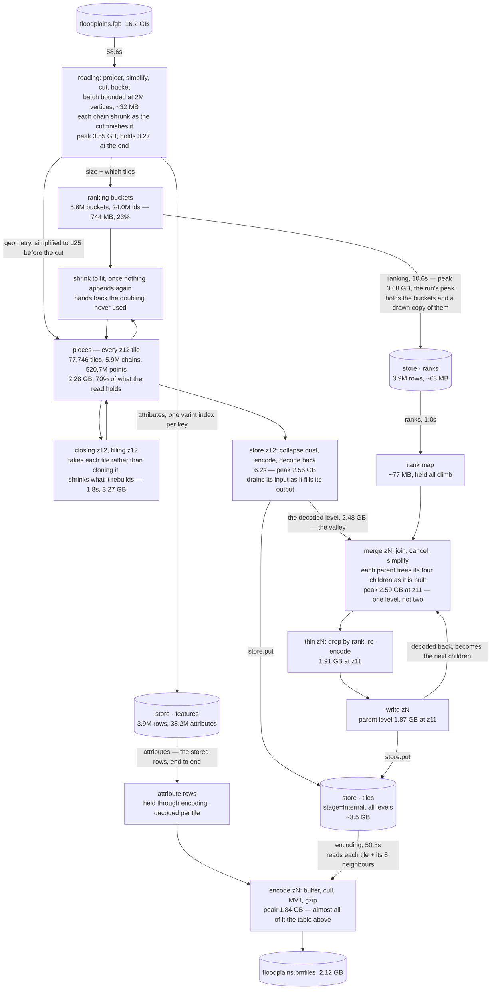

# Where the memory goes

Measured with `--memory`, which needs a binary built with
`./build.sh --features memory-stats`. It prints live bytes — what lyv holds, not
the resident set — on every progress line: the stage's peak on the line that
stays, the current figure on the line being redrawn.

It samples at each progress update (every 0.5s, or `--progress-every`) and
at each end of a stage, so a spike that lives entirely between samples is
missed; one 977 MB spike hid that way. The exact peak is the figure printed at
the end of the run. `--memory` also prints a
breakdown of what is alive after reading (`lyv::footprint`).

A stage line shows that stage's *peak*, not what it left behind, so one line
can't be subtracted from the next.

## Floodplains: 3.9M features, 16.2 GB in, 2.1 GB out

Peak live **3,684 MB**, about a quarter of the input.

| stage | peak | what is held |
|---|---|---|
| reading | 3.55 GB | `pieces` 2.28, ranking buckets 0.74, per-feature costs 0.14 |
| **ranking** | **3.68 GB** | the above, plus a second copy of the buckets |
| store z12 | 2.56 GB | one level in, one out, draining as it goes |
| after ranks | 2.48 GB | the valley: z12's chains and the rank map |
| merge z11 | 2.50 GB | one level, draining into the next |
| each level above | about half the one below | |
| attributes | 1.43 GB | the whole attribute table, decoded (now held as stored rows; not remeasured) |
| encoding | 1.84 GB | that table, plus a tile and its eight neighbours |

What is alive after reading:

```
holding 3270 MB after reading
  pieces       2277 MB  77,746 tiles, 5,932,782 chains, 520,683,398 points
  layer         744 MB  5,644,444 buckets, 24,003,220 ids, 7,340,032 sizes
  facts         143 MB  7,340,032 attribute costs
  unnamed       106 MB  97% of live bytes named
```

**It is the points.** 520M points at four bytes each is 2.08 GB of the 2.28.

Every box below is a stage, every cylinder is on disk, and the figures are peak
live bytes for that stage. The climb keeps each level in memory as well as
writing it to the store, and only the encode pass reads tiles back.



## How it got here

| | peak live | |
|---|---|---|
| start | 15,432 MB | |
| `lyv_merge::group` stopped cloning the level | 15,432 MB | climb −34%, peak unmoved |
| simplification moved ahead of the cut | 11,131 MB | −28% |
| maxzoom stopped simplifying a second time | 11,131 MB | that stage −40%, peak unmoved |
| `store z12` drains its input as it fills its output | 9,132 MB | −18% |
| `merge` stopped cloning the level into its work list | 8,031 MB | −12% |
| *(counter fixed; the program didn't change)* | 7,834 MB | |
| the cut and the ranking shrink to fit | 7,589 MB | −3% |
| the cut shrinks each chain as it finishes it | 7,300 MB | reading −23% |
| `closing z12` stopped re-inflating the level | 5,979 MB | −18% |
| sizes stopped being held twice | 5,979 MB | −210 MB, peak unmoved |
| tile coordinates went from 32 bits to 16 | **3,684 MB** | **−38%** |

No output changed except with simplifying before the cut: simplify-then-clip
keeps different vertices from clip-then-simplify.

**Nearly all of these were one bug:** a stage holding its whole input for its
whole life when it needed it a piece at a time, or keeping a copy or capacity it
had stopped using. The 16-bit change was the only exception — the same data, in
the type it should always have had — and it was also the biggest win.

**When a fix lands, look at the stage it targeted, not the run's peak.** The peak
moved between stages five times during this work. Shrinking each chain in the
cut took `reading` down 23% and the run's peak only 4%, because `closing z12`
immediately rebuilt the slack. Judged by the peak alone, most of these changes
look like failures.

**Measure memory as well as time.** Holding the attribute table in memory was
committed on the strength of `--trace` alone, and turned out to peak at 7.2 GB
until keys were interned and the rows put in one flat arena. It's now held as
the store's rows, decoded per tile (below).

## Things worth knowing

**Vectors grown by doubling carry about ⅓ slack.** `pieces` measured 1.36×, the
textbook 1.33. So vectors are shrunk once nothing will append to them again:
after the read, and again after closing and filling, which rebuild polygon tiles.

**Chains are small**, about nine points each, so `pieces` is millions of small
allocations. One arena per tile would remove them, at the cost of changing
`Chain`.

**The counter publishes per thread.** `lyv_alloc` batches each thread's delta and
flushes it past 256 KB, and must also flush when the thread exits: the cut spawns
workers per batch, so thousands of threads die holding a residual. Before that was
fixed, the error ran in both directions and grew with the input.

**Resident set is far above live.** With `--mmap 0`, floodplains is 7.1 GB
resident against 3.7 GB live: the allocator keeps about 3.4 GB of freed pages
rather than returning them. `--mmap` adds mapped file pages on top of that, per
encode worker (see [speed.md](speed.md)).

**The attribute table set the peak, so it's held as stored.** Decoded, it was a
`Value` per attribute and a `String` per string. On 14.5M Australian addresses
of 29 attributes each that came to 14 GB, and merging the decoding workers'
shares held it twice: a 29 GB peak against 2.4 GB for everything else. It's now
the store's own rows, end to end, and a feature's row is decoded when a tile
asks for it. The encoder takes each decoded value rather than copying it, so
that costs little. On the first 3M of those addresses:

| | peak | encoding |
|---|---:|---:|
| decoded, merged | 6.0 GB | 11.7 s |
| decoded, shares kept | 4.3 GB | 11.3 s |
| stored rows | 1.1 GB | 11.3 s |

On parcels, where a polygon is decoded once per tile it crosses, encoding's
wall time didn't move, and its summed CPU rose 5–10%. Interning values, the
earlier idea, isn't needed.

## What's left

- **The ranking holds its buckets twice.** `sorted_tiles` returns an owned
  `Vec<Vec<u64>>` while `Ranker::rank` still holds the `Layer`. Removing the copy
  is worth about 130 MB of the peak, not the full 414, because `reading` then
  becomes the peak. The fix changes the `Ranker` trait.
- **`Layer`'s `BTreeMap` overhead.** 342 MB of node overhead around 192 MB of ids.
  A flat sorted vector would take about 150 MB off both `reading` and `ranking`.
- **Streaming `pieces` to the store** is the only thing that would move the peak
  much, since `pieces` is most of ingest. Options: exploit spatially sorted input
  (FlatGeobuf's index is Hilbert-sorted, but a river crossing the country keeps
  tiles open everywhere), or read twice — once to rank, once to cut and stream —
  for about +34% wall clock.
- **A disk-backed climb** — reading each parent's children from the store instead
  of keeping the level — would take the climb from 2.5 to about 1.6 GB for about
  +25% wall clock, and change the peak not at all.
- **Levels are encoded twice.** A merged `Parent` holds both chains and encoded
  bytes, and thinning re-encodes, so nine of floodplains' eleven levels encode
  twice and hold both meanwhile. Not measured.
